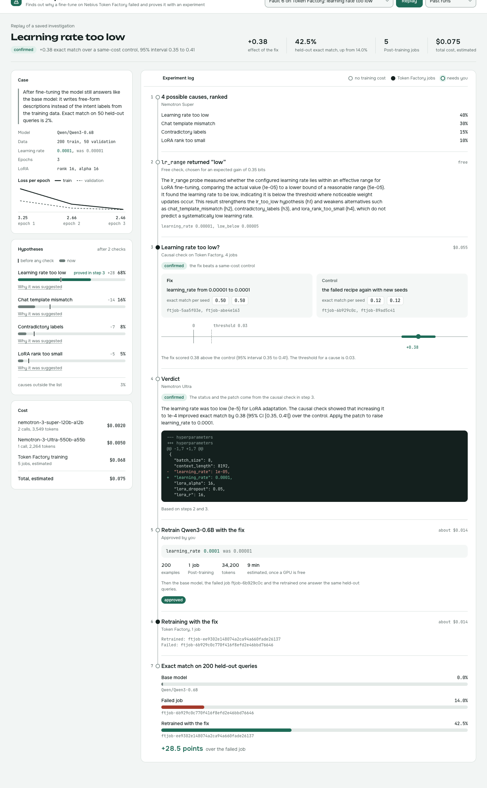

# Next Experiment

An agent that finds out why your LLM fine-tune failed and proves the cause with experiments on Nebius Token Factory.

<picture>
  <source media="(prefers-color-scheme: dark)" srcset="docs/media/investigation-dark.png">
  
</picture>

## What it does

A fine-tuning job can finish with status `succeeded` and still give a model that does not do the task. Next Experiment takes such a job, finds the likely causes, and runs the cheapest experiments that can tell them apart. A cause counts as found only when a causal check proves it: the fix and a control of the same cost train side by side on Token Factory, and the fix has to beat the control by more than the noise between seeds. After you approve the cost, it retrains the model with the fix and compares the base, failed and retrained models on the same held-out queries.

On the saved demo case, a Qwen3-0.6B job trained with a learning rate of 1e-5 answers 14% of 200 held-out queries. The investigation proves the low learning rate with 4 Post-training jobs, and the retrained model answers 42.5%. The whole run, model calls and training, costs about $0.075.

## Architecture

<picture>
  <source media="(prefers-color-scheme: dark)" srcset="docs/media/architecture-dark.svg">
  
</picture>

Next Experiment runs on Nebius Token Factory: Nemotron 3 Super and Ultra do the reasoning, and the Post-training API trains the fix and control jobs of each causal check and the final retrain. The app itself is one Python process: the API, a worker thread for each investigation and the scoring of downloaded adapters. Artifacts go to a local folder, or to an Object Storage bucket in Nebius AI Cloud, eu-north1, with `STORAGE_BACKEND=s3`.

The animation draws one investigation over the parts; its numbers are the steps in the next section.

| Part | Where it runs | Code | What it does |
|---|---|---|---|
| Screen | the browser; the API serves it as one static page | `apps/api/static/index.html` | starts a replay or a live run, shows each step as it streams in, asks before the retrain |
| API | a uvicorn process on your machine | `apps/api/` | creates investigations, streams their events over server-sent events, takes the answer about the retrain |
| Investigation worker | a thread in the same process, one for each investigation | `core/agent/`, `core/planner/`, `core/probes/` | runs the agent loop, sends each step to its model, picks the next probe or check |
| Causal check | the same thread; jobs on Token Factory, or local training with the `local` backend; scoring on the app's machine with CUDA, Apple MPS or the CPU | `core/interventions/`, `jobs/eval_local/` | trains fix and control pairs, downloads the adapters, scores them by exact match, applies the decision rule |
| Storage | a local folder, or a Nebius Object Storage bucket in eu-north1 | `core/connectors/storage.py` | each investigation's status and events, results of the checks, the Tavily cache |
| Models and training | Nebius Token Factory | `core/connectors/token_factory.py` | Nemotron 3 Super and Ultra, the Post-training API |
| Known issues | Tavily | `core/connectors/tavily.py` | searches for problems others reported with the model and the recipe |

The project plan has three parts that are not built yet: a Next.js screen, a separate worker process with a SQLite queue, and hosting on Hugging Face Spaces. Without the queue, investigations are kept in memory and written to storage, so finished ones survive a restart of the app.

## How an investigation runs

1. Tavily searches for problems others reported with the model and recipe. Results are cached, and every investigation has a credit limit.
2. Nemotron 3 Super ranks the possible causes from the fault catalog and gives each a probability.
3. Free level-0 probes read the recipe, the loss per epoch and, when the job's adapter is available, the adapter's weights. The planner picks the next probe by the expected information it gives per dollar and updates the probabilities from a table of outcome likelihoods.
4. A causal check tests the leading cause: the fix and a same-cost control each train as two Post-training jobs. The adapters are downloaded and scored locally by exact match on a separate check set. The cause is confirmed when the fix beats the control by at least the minimum effect and the 95% interval is above zero; with three or more seeds per arm, a permutation test must also give p ≤ 0.05.
5. Nemotron 3 Ultra writes the verdict: the explanation and the patch to the recipe. The status comes from the causal check, not from the model.
6. With your approval, one job retrains the fixed recipe on the whole training file, and the three models answer the same held-out queries.

Each step is streamed to the screen as it happens, and the paid steps show their cost.

Step 4 on the demo case: the fix and the control train two jobs each, and the effect stands far outside the noise between seeds.

<picture>
  <source media="(prefers-color-scheme: dark)" srcset="docs/media/causal-check-dark.svg">
  
</picture>

## Results

The benchmark compares four methods on 13 Token Factory jobs with a known cause: 9 with a learning rate that is too low, in recipes of 3, 6 and 12 epochs at rank 8 or 16, and 4 healthy ones. The thresholds were set on the 5 dev cases; the 8 held-out cases ran once, after that.

| method | top-1 | false alarms | wrong confirmations | fix success | $ per case | jobs per case |
|---|---|---|---|---|---|---|
| Single Ultra (one call, no experiments) | 6/9 | 0/4 | 0 | 0/9 | 0.009 | 0.0 |
| ReAct on Super, same tools | 9/9 | 0/4 | 0 | 6/9 | 0.205 | 4.9 |
| Checklist, every check | 9/9 | 0/4 | 6 | 6/9 | 0.417 | 12.0 |
| Next Experiment | 9/9 | 0/4 | 0 | 6/9 | 0.144 | 3.7 |

Next Experiment finds the same causes as the ReAct agent at 30% lower cost; the saving comes from the healthy cases, where it stops after fewer checks. The checklist also finds every cause, but it proves a second, wrong cause on 6 of the 9 fault cases. `docs/benchmark.md` has both splits, the results case by case, the error analysis and the limits.

The weight probe (B25) separates a too-low learning rate from healthy jobs on Token Factory: with a threshold set on the dev cases, 9 of 9 held-out jobs and 84 of 86 causal-check adapters land on the right side (`docs/b25-lora-weights.md`).

## What is in the repository now

As of 18 October 2026:

| Area | State |
|---|---|
| Token Factory and Tavily connectors, router with a call log of tokens, cost and prompt version | done |
| Planner, level-0 probes on the recipe, loss curve and adapter weights, signature table | done |
| Causal check on Token Factory: fix and control pairs, noise floor, decision rule | done |
| Verdict and patch, full retrain after approval, comparison of three models | done |
| HTTP API with server-sent events and the investigation screen; replay of the saved demo run and live runs | done |
| Benchmark: 13 cases, four methods, scorer, runner with resume, results and error analysis | done |
| Tools: fault sweeps on Token Factory, case builder, reference runs, noise floor, rescoring, checkpoint pruning, local LoRA simulations | done |
| Weight probe in the API's live runner and in the benchmark | not yet; it runs from `scripts/investigate_tf.py` |
| Public demo page, a fresh demo run with the Tavily step, video | not yet |

## Run it

You need Python 3.11 or 3.12 and [uv](https://docs.astral.sh/uv/). Copy `.env.example` to `.env`. Replaying the saved investigation needs no keys. Live runs need `TOKEN_FACTORY_API_KEY`, and the known-issues step needs `TAVILY_API_KEY`.

Replay the demo on the screen, then open http://127.0.0.1:8000 and press Replay:

```bash
uv run uvicorn apps.api.main:app
```

With `PUBLIC_DEMO=true` the server allows only replays. Live runs from the screen train on Token Factory and score adapters locally, so they need the ML groups:

```bash
uv run --group ml --group eval uvicorn apps.api.main:app
```

Investigate the demo case from the command line, with causal checks on Token Factory (about $0.06 and 10 to 20 minutes per check when Token Factory has free capacity). `--job <failed job ID>` also runs the weight probe on that job's adapter:

```bash
uv run --group ml --group eval python -m scripts.investigate_tf
```

Retrain after a confirmed investigation; it shows the price and asks before it starts:

```bash
uv run --group ml --group eval python -m scripts.retrain_tf
```

Rerun the dev benchmark from the cached pairs, without training:

```bash
uv run --group ml --group eval python -m bench.run_bench --split dev --no-train --check-set artifacts/b10/check.jsonl --noise-sd 0.019 --min-effect 0.06
```

Long runs on Token Factory fill the account's limit of 5000 files with checkpoints. Keep this next to them; it keeps each finished job's last checkpoint and deletes the others:

```bash
uv run python -m scripts.tf_prune_checkpoints --delete --watch 10
```

Run the tests:

```bash
uv run --group eval pytest -q
```

## Repository layout

| Path | What is there |
|---|---|
| `apps/api/` | HTTP API, event stream, investigation store and the screen (`static/index.html`) |
| `core/agent/` | investigation loop, model router, prompts, schemas, known issues |
| `core/planner/` | expected information gain, stopping rule, outcome likelihoods, job cost model |
| `core/probes/` | level-0 probes and the signature table |
| `core/interventions/` | fix and control pairs, statistics of the causal check, Token Factory runner, retrain |
| `core/connectors/` | Token Factory, Tavily and storage |
| `core/telemetry/` | call log |
| `bench/` | cases, fault recipes, comparison methods, fixes, references, scorer and runner |
| `jobs/eval_local/` | exact-match scoring of adapters on a Mac |
| `jobs/kaggle/` | LoRA training for the local simulation sweeps |
| `scripts/` | command-line tools: investigations, retrain, sweeps, cases, calibration |
| `demo/` | the saved investigation the screen replays |
| `docs/` | write-ups listed below |
| `docs/animation/` | the scenes of the README's animations, the architecture and the causal check, drawn with [ManimGX](https://github.com/academa-labs/manimgx) and written as SVG by its `svg.py` (MIT) |

## Documents

| File | Contents |
|---|---|
| `docs/benchmark.md` | dev and held-out results, case by case, error analysis, limits |
| `docs/b25-lora-weights.md` | the weight probe: measurements, threshold, why rank is not used |
| `docs/b10-noise-floor.md` | noise between seeds and the decision rule of the causal check |
| `docs/b6-post-training.md` | what a Token Factory LoRA job costs, how long it takes and what it returns |
| `docs/feedback.md` | what we ran into on Token Factory and Nebius AI Cloud, dated |

## Notes on Token Factory

- Training is deterministic: the same files and hyperparameters give a byte-identical adapter, and the `seed` parameter has no effect. Repeats differ only when the training file is shuffled differently.
- `result_files` hold a PEFT adapter, but the weight names lack the `base_model.model.` prefix, so `PeftModel.from_pretrained` loads none of them and leaves random weights with only a warning. `jobs/eval_local/exact_match.py` loads them correctly.
- A job waiting for a GPU shows 0 steps and no queue status, so it looks stalled.
- Every checkpoint counts against the 5000-file limit, one checkpoint per epoch.

`docs/feedback.md` has the details and the dates.

## Limits

- Every fault case in the benchmark has the same cause, a learning rate that is too low. In our sweeps the other planted faults, a small LoRA rank and too many epochs, did not hurt this task.
- One task (BANKING77 intent labels), one model (Qwen3-0.6B), two seeds per arm.
- Training costs in the tables are estimates from token counts and Token Factory's price per million tokens.

## Task labels

Code comments, docs and pull requests name tasks of the project plan by a letter and a number:

| Label | Meaning |
|---|---|
| B<i> | task number i of track B of the plan. This repository holds track B's work. |
| A<i> | task number i of track A. A few comments name one where the code here stands in for that task or leaves room for it. |

The B tasks that appear here:

| Task | What it is | Where |
|---|---|---|
| B1 | Token Factory connector: structured Nemotron output, files, jobs, events, checkpoints | `core/connectors/token_factory.py` |
| B2 | router of steps to Nemotron models and the call log | `core/agent/router.py`, `core/telemetry/` |
| B3 | Tavily connector with a cache and credit limits | `core/connectors/tavily.py` |
| B5 | reference runs: the best recipe for a task and model | `bench/references/`, `scripts/reference_tf.py` |
| B6 | cost and duration model of Post-training jobs | `core/planner/job_cost.py`, `docs/b6-post-training.md` |
| B7 | planted faults 6 to 8 in a recipe | `bench/faults/recipe.py` |
| B8 | fixes and same-cost controls | `core/interventions/pairs.py` |
| B9 | simulation lab: fault sweeps locally and on Token Factory | `jobs/kaggle/`, `scripts/tf_fault_sweep.py` |
| B10 | noise floor between seeds | `scripts/noise_floor.py`, `scripts/rescore_pairs.py`, `docs/b10-noise-floor.md` |
| B11 | statistics and decision rule of the causal check | `core/interventions/stats.py` |
| B13 | versioned prompts | `core/agent/prompts/` |
| B15 | known issues from Tavily | `core/agent/known_issues.py` |
| B16 | planner | `core/planner/` |
| B17 | investigation loop | `core/agent/loop.py` |
| B18 | verdict and patch, retrain after approval, comparison of three models | `core/interventions/retrain.py`, `scripts/retrain_tf.py` |
| B19 | comparison methods for the benchmark | `bench/baselines/` |
| B22 | HTTP API | `apps/api/` |
| B23 | investigation screen | `apps/api/static/index.html` |
| B25 | weight probe on the LoRA adapter | `core/probes/level0/weights.py`, `docs/b25-lora-weights.md` |

## License

Apache 2.0, see `LICENSE`.
