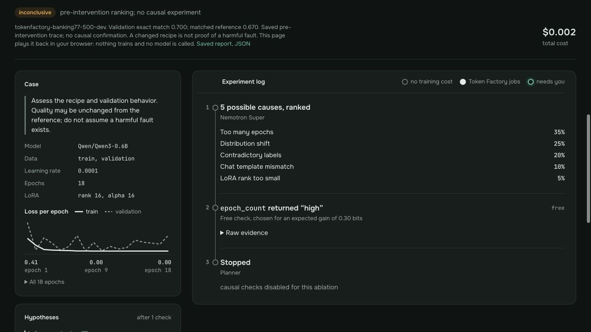

# O2 demo walkthrough

Build the public replays without credentials or training:

```bash
uv run python -m scripts.build_measured_demos
uv run python -m scripts.build_pages --out _site
python -m http.server --bind 127.0.0.1 --directory _site
```

Open localhost:8000 and choose **Answer cuts on Token Factory — measured
experiment**, then Replay. Explain that an upstream script damaged answers before
upload; the provider itself rejected over-limit examples in the recorded test.
The four arms show healthy 92.6%, damaged 68.1%, target 85.9% and control 66.2%
on 770 check examples. The target removes flagged examples; the same-size control
removes random unflagged examples. Show the two-seed caveat and original job IDs,
train hashes and adapter hashes in the sources disclosure.

Choose the Kaggle experiment. Its three-seed comparison has the same arm ordering,
with lower absolute quality. The noise calculation is local to those runs.
Both screens say recovery is partial and identify the replay as an experiment.
No Super hypotheses, Ultra verdict or API investigation trace is invented.

For the agent workflow, choose the historical **Fault 6 on Token Factory** run.
Its stored `confirmed` status means a useful learning-rate intervention against
its control. Explain that uniqueness of the cause requires tests of competing
explanations. This historical run is separate from the answer-cut experiments.

Switch to a local audit to demonstrate that the previous result clears before
Replay. A label or dataset audit shows observations without claiming a measured
quality failure.

O2 still needs a fresh complete answer-cut API investigation with persisted
hypotheses, probe outputs, approval, intervention and final report; a public demo
video and submission packaging are also pending. These replays do not close those
requirements. Any paid run needs its explicit budget and a frozen evaluation plan.

## Long-history replay check

The 18-epoch recipe replay previously expanded its case card to 690 px inside a
360 px sidebar at a 1280 px viewport, overlapping the experiment log. The chart
now labels the first, middle and last epochs and offers all values in a disclosure
table. Grid children can shrink to their allotted column width.

The [original Figma design](https://www.figma.com/design/qSmrm8hTAQLe3WDAD2XaU1/Next-Experiment-%E2%80%94-investigation-screen?node-id=22-268)
uses a 360 px case card and a 318 × 76 px chart. Those desktop dimensions remain.
Browser checks on 19 October 2026 covered the 18-epoch replay at 1280 px and
embedded 390/320 px viewports, the 18-row table and switching to the measured
Token Factory answer-cut replay. The latter clears the previous graph and shows
one measured-experiment step. These checks replay saved data without API calls.

To reproduce, select **Fault 7 recipe: lr 0.0001, rank 16, epochs 18, seed 0 —
inconclusive**, press Replay, then expand **All 18 epochs**. Check that the card
and chart stay inside the sidebar and that the log remains separate.


