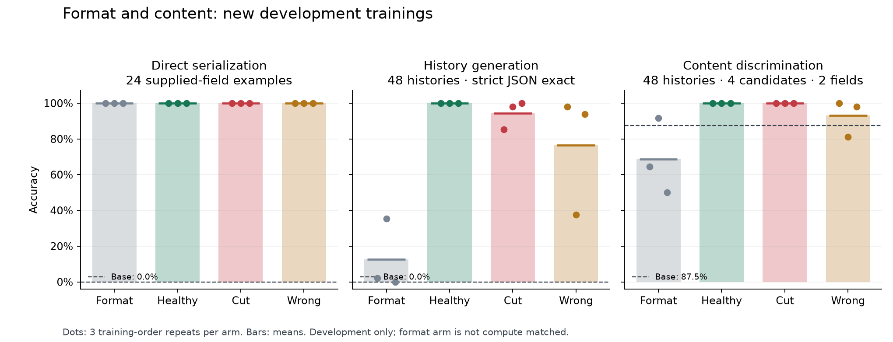

# Format/content development experiment, 19 October 2026

This experiment follows the stopped history-task pilot and the negative transfer
screen of six old adapters. It completed twelve new adapters on 20 October and stopped at three frozen
admission gates. The full results and retry provenance are published below.

## Frozen design

Four arms, each with training-order seeds 1301, 1302 and 1303:

| Arm | 72 common training anchors | 144 training histories |
| --- | --- | --- |
| format | Direct serialization of supplied fields | Converted to direct serialization |
| healthy | Clean | Clean |
| cut | Clean | Half the answers cut at half their characters |
| wrong | Clean | The same half assigned cyclically wrong product and priority, valid JSON |

Each validation set contains 12 anchors and 24 corresponding examples. The check
has 24 unseen direct serializations and 48 unseen histories. Splits use distinct
entities and normalized histories, a new random seed and new IDs/dates, but share
a synthetic grammar. Clean history labels are verified by a text-only replay
parser; direct labels are checked against the supplied field values. This is an
automated single-author review, not independent human annotation.

Qwen3-0.6B LoRA uses two epochs, learning rate 1e-4, batch 8, rank/alpha 16,
dropout .05 and an 8192-token context without packing. All jobs start from the
same base; the format arm is a diagnostic learning control and is not compute
matched because its inputs are shorter.

## Separate measurements

1. Format check: raw schema validity and strict full-object exact match.
2. History generation: strict exact match with greedy decoding, thinking off and
   a fixed 192-token limit. A preplanned diagnostic removes only a single
   canonical Markdown JSON fence. Invalid/unparseable answers remain wrong;
   every example stays in the denominator.
3. Bounded content discrimination: conditional log probability of four fixed,
   equal-token-length canonical JSON completions. Only product and priority
   differ; other fields are supplied in all candidates. The correct completion
   must be the unique maximum (ties within 1e-6 count wrong). This measures
   two-field discrimination, not full open-ended reasoning.

The base model is measured once without a strict-JSON admission gate. All twelve
new trainings are planned before base measurement, so base formatting cannot
cancel the requested training test.

Before any model measurement, the protocol fixes these gates: mean direct
serialization exact >= .90 for format and healthy; healthy choice accuracy in
[.35, .95]; healthy-minus-format and healthy-minus-wrong choice gaps >= .10;
healthy-minus-cut strict-history gap >= .08. Each arm must have three distinct
weight digests. Only after every gate passes does pooled healthy/cut seed noise
enter the inherited power rule (nonzero SD, candidate counts 3–8, 1,000 Monte
Carlo trials, effect .16, minimum effect .08, lower 95% MC bound >= .80).
A pass permits preparation of a new confirmatory protocol; it does not authorize
selection on a final test. A failed gate ends this design without adaptive seeds.

## Accounting and execution

The new cohort copies the complete six-operation spending ledger from
`ticket-updates-development-20261019-v1`, with $0.2710464 previously estimated
before tax. The new ledger is the sole successor, under the inherited $5 cap.
Training reservations use the longest rendered example times rows times two
epochs, at $0.40/M tokens. The authenticated Token Factory price table was
rechecked on 19 October: Qwen3-0.6B LoRa 8K, eu-north1, effective 1 December 2025.
Another $1 is held out of the training admission calculation for future
inference and $.50 for contingency. Provider token counts determine settled
estimates; these are not invoices.

A cohort process lock prevents concurrent commands. Every paid attempt is
recorded before upload/submission. Unknown outcomes retain their ledger hold and
must be reconciled before any retry. Source, runtime, datasets, candidate choices
and injection records are hash-bound before evaluation. On resume, existing complete scores
are verified and reused. No service/UI classifier changes
are part of this experiment.

## Execution result

Protocol SHA-256:
`28ef76e4521cef83040423722ef6265624b019de194af098104a9632ab2d8f09`.
Source commit: `330841d`. The complete series reserves $1.1311488 before tax.
The original twelve jobs stalled at zero reported training steps and were cancelled.
The user authorized one infrastructure retry using the same provider file IDs,
recipe and seeds. All twelve replacements succeeded, each with 54 steps. This is
12 experimental slots and 24 provider submissions. Local evaluation finished on
20 October at 11:36 Moscow (08:36 UTC), with 13 scored models including the base.

The [portable bundle](results/format-content-development-20261019/summary.json)
contains 936 generated answers and 624 four-choice decisions. The
[retry evidence](results/format-content-development-20261019/restart-provenance.json)
binds all original/replacement jobs to seeds, recipe, file IDs and ledger operations.
Each arm has three distinct adapter weight digests.

| Arm | Direct exact | History exact, seeds 1301 / 1302 / 1303 | Mean history exact | Mean four-choice accuracy |
| --- | ---: | --- | ---: | ---: |
| Base | 0% | 0% (one model) | 0% | 87.50% |
| Format | 100% | 2.08% / 35.42% / 0% | 12.50% | 68.75% |
| Healthy | 100% | 100% / 100% / 100% | 100% | 100% |
| Cut | 100% | 85.42% / 97.92% / 100% | 94.44% | 100% |
| Wrong | 100% | 97.92% / 37.50% / 93.75% | 76.39% | 93.06% |



The frozen decision is **stopped**:

| Admission condition | Observed | Decision |
| --- | ---: | --- |
| Format and healthy direct exact ≥ 90% | Both 100% | Pass |
| Healthy four-choice accuracy in [35%, 95%] | 100% | Fail: ceiling |
| Healthy − format choice ≥ 10 percentage points | 31.25 pp | Pass |
| Healthy − wrong choice ≥ 10 percentage points | 6.94 pp | Fail |
| Healthy − cut history exact ≥ 8 percentage points | 5.56 pp | Fail |
| Three distinct weight digests per arm | Three in every arm | Pass |

No seed count was selected and no power simulation was run. Descriptive pooled
healthy/cut SD is 5.58 percentage points for strict history exact and zero for
choice accuracy. These diagnostics cannot override the failed admission gates.

## What the result supports

All trained models learned the direct-serialization check. Training on clean
histories produced 100% history exact, while the format arm averaged 12.50% on
histories. That separates direct field serialization from the history task in
this development set. The format arm uses shorter inputs, so this comparison
does not isolate a compute-matched causal effect.

Cuts produced only eight incorrect/invalid history answers across 144 evaluations,
all in two seeds. Every cut model still selected the right candidate on all 48
histories. The preplanned strict-history effect is too small for admission.
Wrong-value training yielded 34 incorrect history answers across 144 evaluations,
with valid JSON in every case; its errors affect product/priority while the other
three fields remain correct. Its open-generation gap is larger, but switching to
that endpoint after observing the failed choice gate would change the protocol.

The format-s1303 model hit the fixed generation limit on 28/48 histories; all
other trained models had zero history limit hits. Every limited answer stays in
the denominator. Canonical fence removal changes none of the trained models'
strict scores; the base alone improves to 100% direct and 54.17% history exact.
Family and field diagnostics are saved in the summary as descriptive evidence.

## Consequences for the remaining plan

B5/A13 now has a completed four-arm development comparison for this task/model,
but still lacks the three-task × three-model reference matrix. B10 receives a
measured strict-score noise estimate; this series provides no admitted power or
confirmation seed count. The next data-design task is a separately preregistered
development study with fresh histories and enough difficulty to avoid the choice
ceiling. Its data review must precede any new training; this result authorizes no
additional paid runs or adaptive repeats.

The dependent confirmation study, persisted answer-cut API investigation and
final evaluation remain blocked by admission. Historical final-test data remain
protected. T=1 and offline-only classifiers remain the deployment decisions.
B24 pretrained confirmation and B26 transfer validation are not established by
this study. The negative result is suitable for the evidence report and demo
limitations; it is not a successful end-to-end investigation.

## Cost and pending reconciliation

Replacement jobs report 2,117,328 trained tokens: $0.8469312 before tax at the
frozen $0.40/M rate. With inherited estimates of $0.2710464, settled token estimates
total $1.1179776. The twelve cancelled originals report zero steps/tokens, but
$1.1311488 of their reservations remain held until billing is confirmed.
Committed estimates plus holds are $2.2491264; including the $1 future-inference
and $0.50 contingency allowances gives $3.7491264 within the $5 cap.

[Accounting status](results/format-content-development-20261019/accounting.json)
is `cancelled_holds_pending`, and `invoice_reconciled` is false. Usage observed at
06:03 UTC on 20 October predates replacement completion. No hold was released on
the assumption that cancellation is free. The published result is scientifically
complete while billing remains open. The legacy `paid_jobs: 12` completion field
counts experimental slots; the accounting and provenance files record all 24
provider submissions.

| Arm | Rendered training tokens per epoch | Maximum example tokens | Three-job reservation |
| --- | ---: | ---: | ---: |
| format | 61,932 | 292 | $0.1513728 |
| healthy | 97,818 | 630 | $0.3265920 |
| cut | 96,184 | 630 | $0.3265920 |
| wrong | 97,818 | 630 | $0.3265920 |

All check histories are balanced across the three families (16 each). Candidate
position is shuffled and frozen; candidates are scored independently, not shown
as an ordered multiple-choice list to the model.

Reproduce preparation in a new artifact directory with the frozen source commit
and runtime. The generator fixes the RNG; path fields in a regenerated protocol
will differ. Never submit against the historical ledger again.

```bash
.venv/bin/python -m scripts.format_content_development prepare \
  --root artifacts/format-content-development-20261019-v1 \
  --old artifacts/ticket-updates-development-20261019-v1
.venv/bin/python -m scripts.format_content_development submit \
  --root artifacts/format-content-development-20261019-v1 --env-file /path/to/.env
.venv/bin/python -m scripts.format_content_development base \
  --root artifacts/format-content-development-20261019-v1
.venv/bin/python -m scripts.format_content_development collect \
  --root artifacts/format-content-development-20261019-v1 --env-file /path/to/.env
.venv/bin/python -m scripts.format_content_development score \
  --root artifacts/format-content-development-20261019-v1
.venv/bin/python -m scripts.format_content_development analyze \
  --root artifacts/format-content-development-20261019-v1
```

Do not run the paid submission command merely to reproduce analysis. Published
predictions, candidate scores and data are sufficient for rescoring without a
provider call. The terminal decision prevents further scoring/submission in the
same cohort.

To verify a published bundle in a different checkout, without local model files
or credentials:

```bash
.venv/bin/python -m scripts.report_format_content --verify \
  --out docs/results/format-content-development-20261019
```

This rechecks the complete file manifest, frozen data/choice hashes, all 936
answer metrics, 624 choice decisions, family/field summaries, noise, stopping
decision and all 24 job/ledger bindings. It also checks that the cancelled-job
holds remain pending and successful replacements are settled at their token
estimates. Tests reject altered seeds, recipes, file IDs, costs, released holds
and metric summaries even when file manifest hashes are refreshed. It does not
rerun inference, recover weight bytes from their hashes or authenticate a saved
provider receipt independently of its source capture.

Export from the frozen evaluation checkout uses `--allow-cancelled-holds` to
publish the explicit pending-accounting state. Without this option, unresolved
holds still prevent export. The exporter cannot use the option to accept missing
models, pending successful-job costs or unproven cancelled attempts. Export was
completed before merging main; subsequent verification uses the portable bundle
and needs neither the model cache nor provider credentials.

Publication validation: 922 tests passed and 8 were skipped after integrating
main through #99; Ruff lint and formatting passed for 367 Python files. A separate
JSON/object and maximum-logprob audit also reproduced all 936 answer decisions and
624 choice decisions. The chart was rendered and visually checked.
