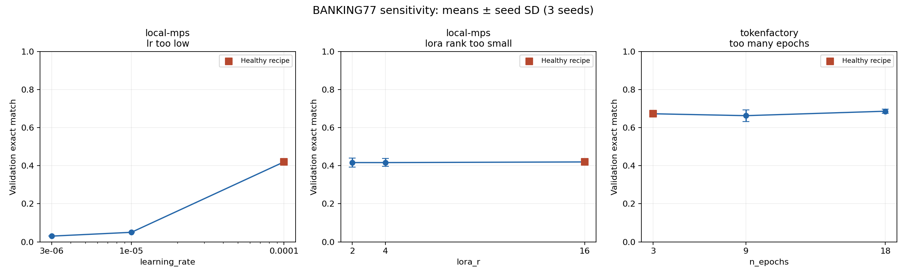
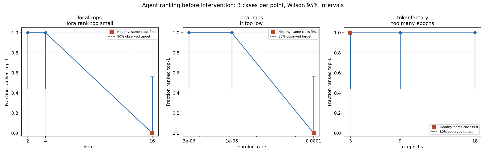

# B7: recipe sensitivity on BANKING77

Measured on October 19, 2026 with Qwen3-0.6B, seeds 0/1/2 and 100 validation
examples. The local study reuses 15 saved MPS runs; the provider study adds nine
Token Factory jobs at 3, 9 and 18 epochs. Both use 500 training examples. Their
baselines differ, so their scores are reported separately.

| Study | Changed parameter | Exact match, mean ± seed SD | Change from matched healthy seed |
| --- | --- | ---: | ---: |
| Local MPS | Healthy: lr 1e-4, rank 16, 3 epochs | 0.420 ± 0.010 | — |
| Local MPS | Learning rate 1e-5 (0.1x) | 0.050 ± 0.000 | −0.370 |
| Local MPS | Learning rate 3e-6 (0.03x) | 0.030 ± 0.000 | −0.390 |
| Local MPS | Rank 4 | 0.417 ± 0.021 | −0.003 |
| Local MPS | Rank 2 | 0.417 ± 0.023 | −0.003 |
| Token Factory | Healthy: 3 epochs | 0.673 ± 0.015 | — |
| Token Factory | 9 epochs (3x) | 0.663 ± 0.031 | −0.010 |
| Token Factory | 18 epochs (6x) | 0.687 ± 0.012 | +0.013 |



Low learning rate causes a large reduction in validation exact match in the local
study. Rank 2/4 barely changes the mean. More epochs do not produce a consistent
decrease across the measured strengths. These data therefore do not validate low
rank or extra epochs as harmful faults on this configuration. The injected recipes
remain available, but their names alone are insufficient evidence of a failure.

The intervals in the plot are seed standard deviations, not confidence intervals.
Three seeds on the same validation set do not establish held-out performance,
causal significance, or transfer to another task/model. No decision threshold or
prior is fitted from these curves. Token Factory does not support ranks 2/4;
those measurements use the local backend. The interrupted preliminary local
epoch run is excluded.

## Evidence and reproduction

The [protocol](results/b467-20261019/protocol.md) records sources, hashes, fixed
parameters, seed ordering and budget assumptions. [Local inputs](results/b467-20261019/local-sensitivity.json)
reference the existing source summaries by path and hash. [Provider inputs](results/b467-20261019/epoch-sensitivity.json)
include all nine job IDs, checkpoint losses, token counts, exact-match scores and
source hashes; the original summaries and evaluations are saved in
`results/b467-20261019/epochs/`. Local evaluation versions are recorded in
[environment.json](results/b467-20261019/environment.json).

The nine new trainings report 2,549,520 trained tokens in total, giving an estimated
$1.019808 at $0.40/M. Local adapter evaluation makes no paid inference calls.
This estimate is not a provider billing receipt.

Replot the saved measurements without training or inference:

```bash
uv run --with matplotlib==3.10.7 python -m scripts.plot_sensitivity \
  docs/results/b467-20261019/sensitivity.json \
  --out artifacts/recipe-sensitivity.png
```

`bench.sensitivity.summarize_study` rejects mixed studies, unmatched or duplicate
seeds, invalid scores and comparisons that change another recipe field.

## Agent detection before intervention

The unchanged agent was run once on each of the 24 saved cases. It saw the
hyperparameters, checkpoint losses and quality relative to the same-seed baseline;
truth labels and source paths were excluded. We score its top-ranked listed
hypothesis at the point before causal intervention. This uses the existing benchmark
ranking convention, including its exclusion of unlisted probability mass.

| Injected recipe | Recoveries at weaker strength | Recoveries at stronger strength | Weakest tested setting with observed recovery ≥80% |
| --- | ---: | ---: | --- |
| Low learning rate | 3/3 at 1e-5 | 3/3 at 3e-6 | 1e-5 (0.1x) |
| Low rank | 3/3 at rank 4 | 3/3 at rank 2 | rank 4 |
| Extra epochs | 3/3 at 9 epochs | 3/3 at 18 epochs | 9 epochs (3x) |



These are observed thresholds on the tested grid. The Wilson 95% lower bound for
3/3 is only 43.8%, so no setting establishes an 80% population recovery rate.
There is no interpolation to untested strengths or claim of independent held-out
validation. Baseline plus two strengths provides three parameter levels.

All three healthy provider cases also rank `too_many_epochs` first. The local
healthy cases rank other fault classes first. Thus all six healthy cases receive
a named fault as their top listed hypothesis, although none is causally confirmed.
Perfect injected-recipe recovery therefore does not establish useful failure
detection, especially for epochs. The default prompt frames cases as failed
fine-tunes; this run exposes its behavior on healthy inputs without tuning the
prompt against these results.

The [detection report](results/b467-20261019/detection/report.json) includes healthy
counts, intervals and separate observed/statistically supported threshold fields.
The same directory contains all observations, investigation traces and call logs.
There were 24 successful investigations and no provider/structured-output errors;
the recorded inference cost is $0.042102. No causal interventions were trained or
replayed, and no confirmed-detection sensitivity is claimed.

Replot without model calls:

```bash
uv run --with matplotlib==3.10.7 python -m scripts.plot_detection_sensitivity \
  docs/results/b467-20261019/detection/report.json \
  --out artifacts/detection-sensitivity.png
```
