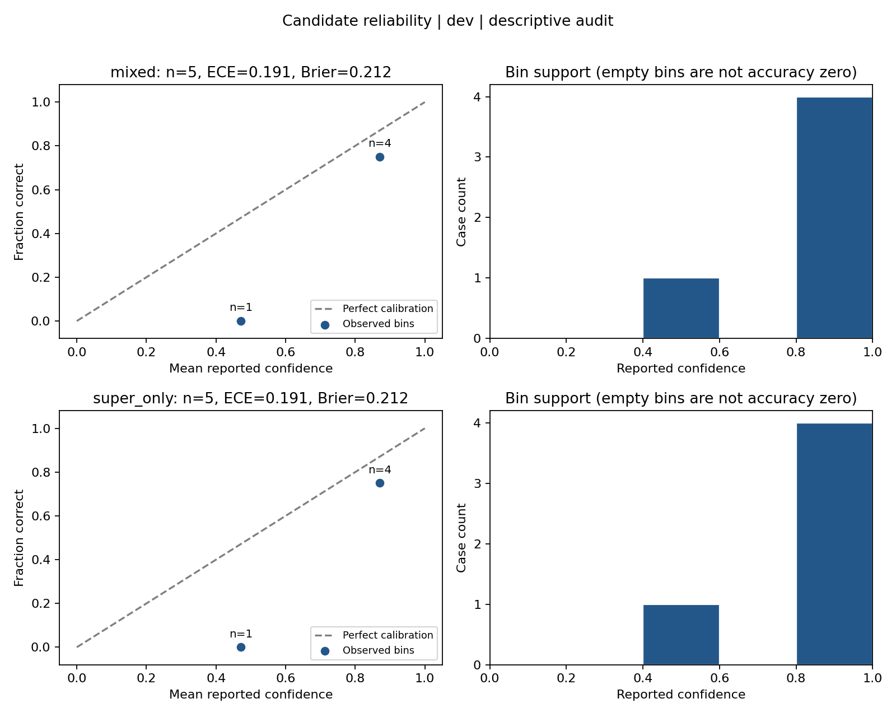

# Candidate reliability diagram

The B12 diagram compares reported confidence with observed candidate accuracy.
Each point represents an occupied confidence bin; its label gives the number of
cases. The diagonal marks equal confidence and accuracy. Points below it indicate
overconfidence in that bin. Empty bins have no accuracy point. The adjacent
histogram shows support for every bin.



This figure uses the saved Mixed and Super-only routing comparison: five dev
cases per method, including two healthy cases. Both methods have the same
rankings, ECE 0.19054 and binary Brier 0.21186. This small descriptive audit does
not establish calibration on new cases. The figure shows raw reported confidence;
no temperature is fitted or applied. Correctness and candidate selection follow
[the confidence audit](confidence-calibration.md).

The [JSON report](results/reliability-dev-20261018/report.json) contains per-case
decisions, bin counts, metrics and source/truth hashes. The
[SVG](results/reliability-dev-20261018/reliability.svg) can be used in slides.

Reproduce into a new directory:

```bash
uv run --with matplotlib==3.10.7 python -m bench.reliability_plot \
  docs/results/dev-routing-20261018/rows.json \
  --split dev --bins 5 \
  --out artifacts/reliability-dev
```

The command accepts the same JSON/JSONL predictions as `bench.calibration` and
requires complete split coverage. It refuses to overwrite an existing output
directory. Matplotlib is needed only for plotting. No model calls or training
are performed; fitting temperature remains a separate offline operation.
